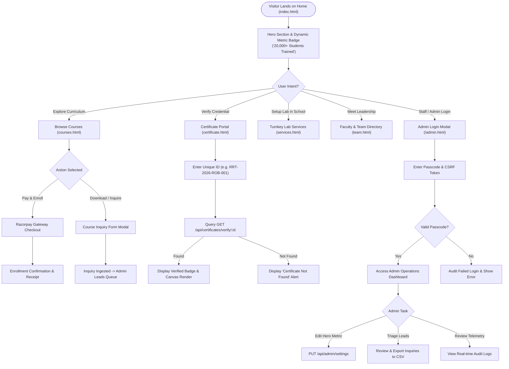

# Application User Flow Document (APP_FLOW)

**Product Name:** Robotree Robotics Corporate & STEM Education Web Platform  
**Document Version:** 2.1.0  
**Status:** Approved & Implemented  
**Entity:** Robotree Robotics LLP (GeM & MSME Accredited Entity)  
**Author:** Lead UX Architect & Senior Fullstack Engineer  

---

## 01. Overview

| Field | Detail |
|:---|:---|
| **Product Name** | Robotree Robotics Corporate & STEM Education Platform |
| **Purpose** | Map end-to-end user journeys, screen interactions, decision trees, and administrative management workflows. |
| **Target Users** | School Students (Grades 1-12), Engineering Scholars, School Principals/Educators, Corporate Partners, and Platform Admins. |
| **Supported Platforms** | Responsive Web (Mobile browsers, Tablet, Desktop Chrome/Firefox/Safari/Edge). |
| **Current Version** | v2.1.0 (Enterprise MVC + Services Architecture) |

---

## 02. High-Level User Journey

---

## 03. Key Screens & Component Hierarchy

### Screen 1: Home Landing Page (`index.html`)
- **Header & Navigation Bar:**
  - Sticky glassmorphic navbar with Robotree brand emblem.
  - Links to: About, Courses, Services, Team, Gallery, Certificate, Contact.
  - Quick action: "Contact Us" primary CTA button.
- **Hero Presentation:**
  - Dynamic value proposition: "Empowering the Next Generation with Robotics & AI".
  - Floating Live Metric Badge: Hydrated dynamically from `/api/site-settings` (Default: `20,000+ Students Trained`).
  - Dual CTAs: "Explore Courses" and "Book Institutional Consultation".
- **Accreditation Ticker:**
  - Government of India GeM & MSME accreditation badges.
  - Institutional partner logos (NITs, JNVs, KVs).
- **Core Pillars Grid:**
  - Hands-on Robotics Kits, AI & Python Workshops, Drone Aviation Labs, 3D Prototyping.
- **Footer Section:**
  - Mandatory Government of India Protocol compliance notice (no commercial copyright).

### Screen 2: Courses Catalog (`courses.html`)
- **Domain Filter Tabs:** All, Robotics, Artificial Intelligence, IoT & Smart Devices, Drone Aviation, 3D Printing.
- **Course Card Matrix:**
  - Course thumbnail, duration badge, skill level, and curriculum syllabus pills.
  - Pricing display in INR (`₹`).
  - Action buttons: "Enroll via Razorpay" & "Download Prospectus".
- **Curriculum Details Drawer:**
  - Slide-in modal presenting week-by-week learning roadmap and hardware kit specs.

### Screen 3: Certificate Verification Portal (`certificate.html`)
- **Lookup Card:**
  - Centered search container with input mask for ID (e.g. `RRT-2026-XXXX`).
  - Interactive "Verify Now" button with asynchronous loading spinner.
- **Result Verification Panel:**
  - Displays authenticated student name, course title, grade, completion date.
  - GeM & MSME verified accreditation seal.
  - High-resolution HTML5 Canvas rendering enabling instant PNG download.

### Screen 4: Turnkey Lab Services (`services.html`)
- **B2B Offerings:** Atal Tinkering Labs (ATL) setup, Advanced Robotics & Drone Labs, AI Innovation Labs.
- **Interactive Lab Quotation Builder:**
  - Selection of student seating capacity (30, 60, 100+).
  - Kit selection checklist.
  - Instant submission to `/api/program-interest`.

### Screen 5: Administrative Dashboard (`admin.html`)
- **Security Checkpoint:**
  - Initial modal requiring administrator passcode.
  - Protected by CSRF token and rate-limiting middleware.
- **Dashboard Telemetry Overview:**
  - Metric counters: Total Inquiries, Active Students, Verified Certificates, Total Page Views.
- **Site Settings & Metrics Editor (New):**
  - Live editing fields for: Hero Stat Number, Hero Stat Label, and Government Protocol Notice.
  - Real-time preview card matching the homepage floating badge styling.
  - "Save Settings" button with status toast.
- **Lead & Inquiry Table:**
  - Filterable records by status: New, Contacted, Enrolled, Closed.
  - Search bar by name, email, or phone.
  - "Export to CSV" button.
- **System Audit Log Viewer:**
  - Real-time timestamped events: Admin logins, settings updates, user registrations, lead submissions.

---

## 04. Detailed Sub-Flows

### 4.1 Lead & Contact Submission Flow
1. User completes contact form on [`contact.html`](file:///c:/Users/aniket/Desktop/webiste%20project/contact.html).
2. Frontend requests fresh CSRF token via `GET /api/csrf-token`.
3. Form payload (`name`, `email`, `phone`, `subject`, `message`) dispatched via `POST /api/contact` with `x-csrf-token` header.
4. `InquiryController` validates payload with Zod schema (`inquiry.validator.ts`).
5. `InquiryService` persists inquiry, logs audit record, and triggers notification.
6. Frontend displays animated green checkmark with ticket confirmation.

### 4.2 Dynamic Site Settings Editing Flow
1. Authenticated administrator navigates to **"Site Settings & Metrics"** in [`admin.html`](file:///c:/Users/aniket/Desktop/webiste%20project/admin.html).
2. Administrator alters the Hero Stat Number (e.g. changes `20,000+` to `25,000+`).
3. Admin clicks **"Save Website Settings"**.
4. Client sends `PUT /api/admin/settings` with CSRF cookie and authorization session.
5. `AdminController` forwards update to `AdminService.updateSiteSettings()`.
6. Atomic file update commits changes to [`data/settings.json`](file:///c:/Users/aniket/Desktop/webiste%20project/data/settings.json).
7. Success toast displayed; all future visitors to [`index.html`](file:///c:/Users/aniket/Desktop/webiste%20project/index.html) receive hydrated metric immediately.

### 4.3 Certificate Verification Flow
1. Employer or academic official navigates to [`certificate.html`](file:///c:/Users/aniket/Desktop/webiste%20project/certificate.html).
2. Official enters certificate serial ID and clicks "Verify".
3. Client requests `GET /api/certificates/verify/:id`.
4. `CertificateController` invokes `CertificateService.verifyCertificate(id)`.
5. Service queries `ICertificateRepository` and validates digital signature.
6. JSON response returns student data, certification date, and status.
7. Canvas element dynamically draws high-DPI certificate certificate preview.
