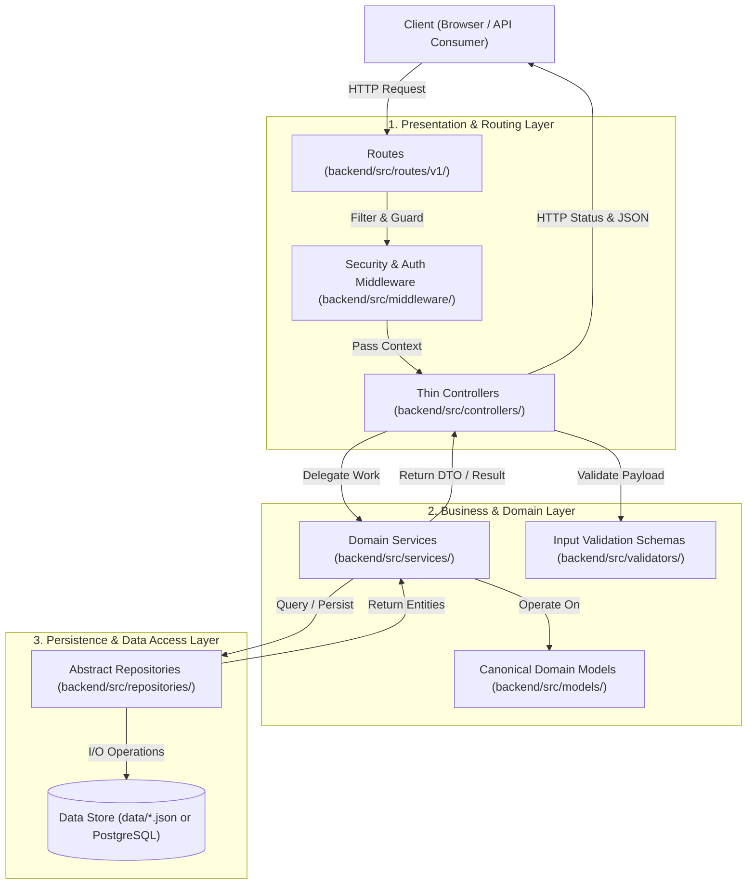
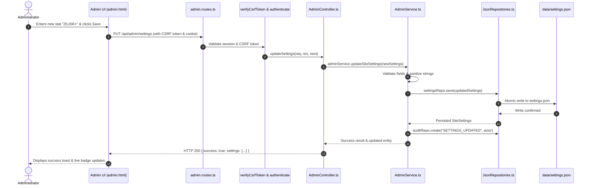
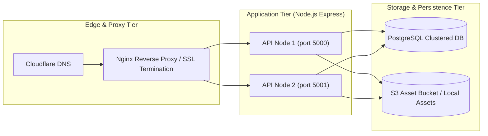

# System Architecture Specification (ARCHITECTURE)

**Product Name:** Robotree Robotics Corporate & STEM Education Web Platform  
**Document Version:** 2.1.0  
**Pattern:** Enterprise Layered MVC + Services Architecture  
**Entity:** Robotree Robotics LLP (GeM & MSME Accredited Entity)  
**Author:** Principal Enterprise Systems Architect  

---

## 01. Architectural Vision & Foundational Pattern

The Robotree platform is engineered using the industry-standard **MVC + Services** architectural pattern, as recommended for scalable, maintainable enterprise backends. This pattern enforces strict separation of concerns, decouples HTTP transport from business logic, and guarantees testability.

---

## 02. Architectural Layer Responsibilities

### 2.1 Routing & Middleware Layer
- **Routes (`backend/src/routes/v1/`):**
  - Defines the REST API endpoints and maps HTTP verbs (`GET`, `POST`, `PUT`, `DELETE`).
  - Connects specific routes to middleware guards and controller methods.
- **Middleware (`backend/src/middleware/`):**
  - **`securityHeaders.ts`:** Injects CSP, HSTS, `X-Frame-Options: DENY`, `X-Content-Type-Options: nosniff`.
  - **`csrf.ts`:** Validates double-submit cryptographic tokens for state-modifying requests.
  - **`rateLimiter.ts`:** Throttles incoming requests per IP to safeguard against brute-force attacks.
  - **`authenticate.ts`:** Authenticates session tokens for administrative or employee portals.
  - **`requestLogger.ts`:** Captures request IDs, execution latency, and client telemetry.

### 2.2 Controller Layer (Thin HTTP Orchestration)
- **Controllers (`backend/src/controllers/`):**
  - Controllers contain **zero business logic** and **zero direct database access**.
  - Responsibilities are strictly limited to:
    1. Extracting parameters, body, and query arguments from the Express `Request`.
    2. Invoking the appropriate Service method.
    3. Serializing and returning HTTP status codes (200, 201, 400, 401, 404, 500) and JSON payloads via the Express `Response`.
    4. Catching unhandled exceptions and forwarding them to `next(err)`.

### 2.3 Service Layer (Core Business Engine)
- **Services (`backend/src/services/`):**
  - Encapsulates all domain rules, business calculations, deduplication logic, and security workflows.
  - Coordinates multi-step transactions and cross-cutting concerns (e.g. audit logging, notifications).
  - Key Services:
    - **`InquiryService`:** Contact form routing, newsletter deduplication, program interest tracking.
    - **`AdminService`:** Dashboard telemetry metrics, dynamic site settings mutations, user management.
    - **`AuthService`:** Password verification via Argon2id, session token issuance, GDPR erasure.
    - **`CertificateService`:** Accreditation checks, verification hash validation.

### 2.4 Repository Layer (Data Access Abstraction)
- **Repositories (`backend/src/repositories/`):**
  - Completely decouples the application from physical database technologies.
  - Defined by pure TypeScript contracts (`IUserRepository`, `IInquiryRepository`, `ICourseRepository`).
  - Supports dual execution engines:
    - **JSON Persistence (`JsonRepositories.ts`):** Atomic file read/write with concurrency locking.
    - **PostgreSQL Persistence (`PostgresRepositories.ts`):** Connection pool queries via SQL.

### 2.5 Domain Model Layer
- **Models (`backend/src/models/`):**
  - Strongly typed TypeScript domain entities representing real-world business constructs (`User`, `Certificate`, `Course`, `Inquiry`, `SiteSettings`, `AuditLog`).

---

## 03. End-to-End Request Lifecycle

To illustrate the clean separation, consider the **Dynamic Site Settings Update** flow:

---

## 04. Error Handling & Exception Taxonomy

The platform implements a centralized, predictable error handling system using custom domain error classes:

- **`AppError` (`backend/src/errors/AppError.ts`):**
  - Standard base exception carrying an HTTP status code, operational flag, and user-safe message.
  - Common Subclasses / Factory Methods:
    - `AppError.badRequest(msg)` -> HTTP 400
    - `AppError.unauthorized(msg)` -> HTTP 401
    - `AppError.forbidden(msg)` -> HTTP 403
    - `AppError.notFound(msg)` -> HTTP 404
    - `AppError.internal(msg)` -> HTTP 500
- **Centralized Error Middleware (`backend/src/middleware/errorHandler.ts`):**
  - Intercepts all rejected promises from controller calls via `next(err)`.
  - Distinguishes between operational errors (returned safely to client) and unexpected programmer bugs (logged to telemetry with stack traces, masked as generic 500 to prevent information leakage).

---

## 05. Scalability & Deployment Topology

