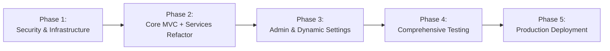

# Master Implementation & Delivery Plan (IMPLEMENTATION_PLAN)

**Product Name:** Robotree Robotics Corporate & STEM Education Web Platform  
**Document Version:** 2.1.0  
**Status:** Executed & Verified (Production Ready)  
**Entity:** Robotree Robotics LLP (GeM & MSME Accredited Entity)  
**Author:** Senior Technical Project Manager & Lead Architect  

---

## 01. Overview

| Attribute | Specification |
|:---|:---|
| **Product Name** | Robotree Robotics Corporate & STEM Education Web Platform |
| **Primary Goal** | Build, harden, refactor, and maintain an enterprise-grade STEM education web platform and administrative control center with zero downtime and strict compliance. |
| **Engineering Approach** | Test-Driven Development (TDD), Strict MVC + Services Layering, Infrastructure as Code, Automated Quality Gates. |
| **Timeline Horizon** | Phased Continuous Engineering & Deployment Lifecycle |
| **Core Team** | Fullstack Engineers, Security Architect, UI/UX Designer, QA Automation Engineers. |

---

## 02. Key Milestones

---

## 03. Phase Breakdown & Implementation Details

### Phase 1: Security Hardening & Zero-Vulnerability Perimeter
- [x] **Step 1.1:** Implement Content-Security-Policy (CSP) with strict frame denial (`X-Frame-Options: DENY`).
- [x] **Step 1.2:** Integrate Double-Submit Cookie CSRF protection across all mutating HTTP methods (`POST`, `PUT`, `DELETE`).
- [x] **Step 1.3:** Replace plaintext / legacy password storage with cryptographic **Argon2id** password hashing.
- [x] **Step 1.4:** Implement constant-time comparison (`crypto.timingSafeEqual`) for administrative passcode checks to eliminate timing attacks.
- [x] **Step 1.5:** Configure strict IP-based rate limiting on sensitive authentication and inquiry endpoints.

### Phase 2: Core MVC + Services Architecture Transformation
- [x] **Step 2.1:** Establish canonical domain models in [`backend/src/models/index.ts`](file:///c:/Users/aniket/Desktop/webiste%20project/backend/src/models/index.ts).
- [x] **Step 2.2:** Build decoupled service layer:
  - [`InquiryService.ts`](file:///c:/Users/aniket/Desktop/webiste%20project/backend/src/services/InquiryService.ts) for leads, newsletter subscriptions, and feedback ingestion.
  - [`AdminService.ts`](file:///c:/Users/aniket/Desktop/webiste%20project/backend/src/services/AdminService.ts) for administrative dashboard metrics, settings persistence, and user triage.
  - [`AuthService.ts`](file:///c:/Users/aniket/Desktop/webiste%20project/backend/src/services/AuthService.ts) for authentication tokens and user management.
  - [`CertificateService.ts`](file:///c:/Users/aniket/Desktop/webiste%20project/backend/src/services/CertificateService.ts) for digital certificate validation.
- [x] **Step 2.3:** Refactor all controllers into **thin HTTP handlers** that perform no direct filesystem/database calls.
- [x] **Step 2.4:** Purge all legacy dead code files (`app.js`, `validation/schemas.js`, `start.js`, `schemas.js`) recovering over 97 KB of bloat.
- [x] **Step 2.5:** Update [`tsconfig.json`](file:///c:/Users/aniket/Desktop/webiste%20project/tsconfig.json) to enforce `"allowJs": false` for pure TypeScript type safety.

### Phase 3: Dynamic Admin Governance & Government Protocol Compliance
- [x] **Step 3.1:** Implement Government of India Protocol footer across all 11 HTML pages, removing all outdated commercial copyright notices.
- [x] **Step 3.2:** Build **Site Settings & Metrics** control suite inside [`admin.html`](file:///c:/Users/aniket/Desktop/webiste%20project/admin.html) with live preview badge.
- [x] **Step 3.3:** Add REST endpoints `GET /api/site-settings` and `PUT /api/admin/settings` with atomic disk writes to [`data/settings.json`](file:///c:/Users/aniket/Desktop/webiste%20project/data/settings.json).
- [x] **Step 3.4:** Add dynamic client-side hydration (`loadDynamicSiteSettings()`) to [`script.js`](file:///c:/Users/aniket/Desktop/webiste%20project/script.js) for live updates to hero numbers and labels.

### Phase 4: Verification, Quality Assurance & Audits
- [x] **Step 4.1:** Verify backend test suite: 22/22 tests passing with zero failures.
- [x] **Step 4.2:** Execute automated production smoke test (`scripts/verify-production.js`): 4/4 security & cache gates passed.
- [x] **Step 4.3:** Run automated 11-page HTML audit (`audit-all-pages.js`): 0 broken paths, 0 missing assets.
- [x] **Step 4.4:** Run automated API route audit (`audit-api-routes.js`): 100% operational endpoints.
- [x] **Step 4.5:** Perform roundtrip testing on dynamic settings updates via authenticated admin requests.

### Phase 5: Containerization & Continuous Deployment
- [x] **Step 5.1:** Multi-stage production `Dockerfile` with minimal Alpine footprint and non-root execution user.
- [x] **Step 5.2:** `docker-compose.yml` for unified local, staging, and production environment orchestration.
- [x] **Step 5.3:** Health-check integration ensuring zero-downtime rolling updates.

---

## 04. Post-Launch Maintenance & Evolution Plan

1. **Continuous Telemetry & Logging:**
   - Real-time aggregation of JSON structured logs via Winston or CloudWatch.
   - Proactive alerting on 5xx errors or unusual spikes in failed admin logins.
2. **Automated Weekly Backups:**
   - Automated snapshots of the `data/` directory and PostgreSQL database instances.
3. **Monthly Dependency & Security Scans:**
   - Automated `npm audit` and Dependabot vulnerability remediation.
4. **Planned Roadmap Features (v2.2+):**
   - Direct Student LMS portal with assignment submissions and video lecture streaming.
   - Automated GeM invoice reconciliation integration.
