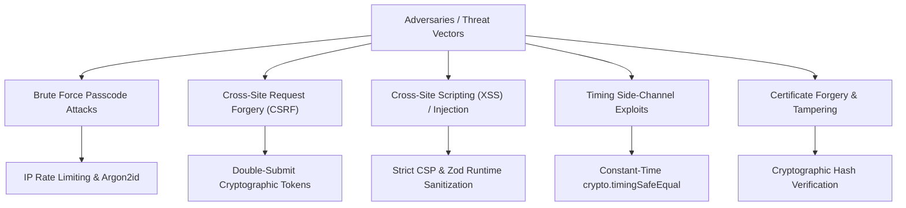

# Security Architecture & Compliance Model (SECURITY)

**Product Name:** Robotree Robotics Corporate & STEM Education Web Platform  
**Document Version:** 2.1.0  
**Status:** Enforced & Production Hardened  
**Entity:** Robotree Robotics LLP (GeM & MSME Accredited Entity)  
**Author:** Chief Information Security Officer (CISO) & Security Architect  

---

## 01. Threat Model & Security Posture

The Robotree platform is designed according to **Defense in Depth** and **Zero Trust** principles. It serves educational institutions, university candidates, corporate clients, and public stakeholders, making data integrity, credential authenticity, and privacy paramount.



---

## 02. Authentication & Cryptographic Standards

### 2.1 Password Hashing with Argon2id
The platform rejects insecure legacy hash algorithms (MD5, SHA1, plaintext) in favor of **Argon2id** (the state-of-the-art winner of the Password Hashing Competition):
- **Algorithm:** Argon2id (resistant against both GPU side-channel and tradeoff attacks).
- **Time Cost:** 3 iterations.
- **Memory Cost:** 64 MB (`65536` KiB).
- **Parallelism:** 4 threads.
- **Salt Length:** 16 cryptographically random bytes (`crypto.randomBytes(16)`).

### 2.2 Constant-Time Passcode Evaluation
To eliminate timing side-channel attacks during administrative authentication, passcode comparisons never use naive string comparison (`===`). Instead, strings are padded to identical buffer lengths and evaluated via constant-time hardware comparisons:

```typescript
// backend/src/security/timingSafe.ts
import crypto from 'node:crypto';

export function timingSafeEqualString(a: string, b: string): boolean {
  const bufA = Buffer.from(a);
  const bufB = Buffer.from(b);
  if (bufA.length !== bufB.length) {
    // Pad to match lengths and fail safely in constant time
    crypto.timingSafeEqual(bufA, bufA);
    return false;
  }
  return crypto.timingSafeEqual(bufA, bufB);
}
```

---

## 03. Cross-Site Request Forgery (CSRF) Protection

The application employs the **Double-Submit Cookie Pattern** with cryptographic HMAC verification:
1. When clients initialize a session, a random CSRF token is generated and delivered via cookie and JSON response (`GET /api/csrf-token`).
2. Every mutating request (`POST`, `PUT`, `DELETE`, `PATCH`) must supply the token in the `x-csrf-token` HTTP header.
3. The server validates that the header token matches the signed session cookie. Requests lacking valid tokens are immediately terminated with `HTTP 403 Forbidden`.

---

## 04. HTTP Header Hardening & Content-Security-Policy (CSP)

Every HTTP response emitted by the Express server is intercepted by [`securityHeaders.ts`](file:///c:/Users/aniket/Desktop/webiste%20project/backend/src/middleware/securityHeaders.ts) and decorated with industry-standard defensive headers:

| Header | Configured Value | Purpose |
|:---|:---|:---|
| `Content-Security-Policy` | `default-src 'self'; script-src 'self' 'unsafe-inline' https://checkout.razorpay.com; style-src 'self' 'unsafe-inline' https://fonts.googleapis.com; font-src 'self' https://fonts.gstatic.com; img-src 'self' data: https:;` | Mitigates XSS and unauthorized script execution. |
| `Strict-Transport-Security` | `max-age=63072000; includeSubDomains; preload` | Forces HTTPS transport for 2 years. |
| `X-Frame-Options` | `DENY` | Prevents UI redressing and clickjacking. |
| `X-Content-Type-Options` | `nosniff` | Inhibits MIME-type sniffing by browsers. |
| `Referrer-Policy` | `strict-origin-when-cross-origin` | Minimizes referrer leakage. |
| `Permissions-Policy` | `camera=(), microphone=(), geolocation=()` | Disables browser hardware access. |

---

## 05. Input Validation, Sanitization & Schema Defense

- **Zod Runtime Validation:** Every incoming API request body, query parameter, and route parameter is validated using strict Zod schemas before reaching business logic.
- **XSS HTML Sanitization:** Free-text fields (such as contact inquiry messages) are sanitized to neutralize potential `<script>`, `onerror`, or `<iframe` payloads.
- **Type Coercion Prevention:** Strict typing prevents prototype pollution and unexpected object mutations.

---

## 06. Rate Limiting & Denial-of-Service Defense

In-memory IP-based rate limiters are deployed across all API endpoints:
- **Public API Endpoints:** 120 requests per 15-minute window per IP.
- **Authentication Endpoints (`/api/admin/login`, `/api/auth/login`):** 10 attempts per 15-minute window per IP to thwart automated brute-force attacks.
- Exceeded thresholds result in `HTTP 429 Too Many Requests` responses with `Retry-After` headers.

---

## 07. Audit Logging & Forensics

All security-sensitive operations are captured in immutable audit records stored in `data/audit_logs.json`:
- `ADMIN_LOGIN_SUCCESS` / `ADMIN_LOGIN_FAILED`
- `USER_LOGIN` / `USER_LOGIN_FAILED`
- `ACCOUNT_CREATED` / `ACCOUNT_DELETED`
- `SETTINGS_UPDATED` (Capturing administrator actor and modified fields)
- `DATA_SUBJECT_EXPORT` (GDPR Data Subject Access Request)

Each log record includes an RFC 3339 timestamp, actor identity, action type, IP address, and contextual details.

---

## 08. Government of India Protocol & Privacy Compliance

- **Accreditation Mandate:** In compliance with Government of India GeM & MSME procurement directives, all proprietary copyright claims have been removed across all 11 HTML pages.
- **Data Protection (DPDP / GDPR):**
  - **Granular Cookie Consent:** Explicit opt-in banner before non-essential tracking cookies are stored.
  - **Right to Access / Data Portability:** Endpoint `GET /api/auth/export-data` enables users to download their complete profile and course activity in JSON format.
  - **Right to Erasure (Right to be Forgotten):** Endpoint `POST /api/auth/delete-account` allows users to permanently delete their account and anonymize their contact inquiries.
