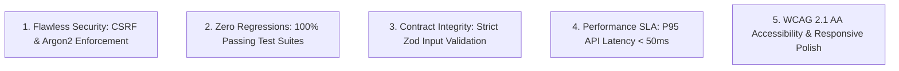

# Quality Assurance & Testing Guide (TESTING)

**Product Name:** Robotree Robotics Corporate & STEM Education Web Platform  
**Document Version:** 2.1.0  
**Status:** Active & Enforced  
**Entity:** Robotree Robotics LLP (GeM & MSME Accredited Entity)  
**Author:** Lead QA Automation Engineer & Principal Architect  

---

## 01. Overview

| Attribute | Specification |
|:---|:---|
| **Product Name** | Robotree Robotics Corporate & STEM Education Web Platform |
| **Purpose** | Define the comprehensive verification strategy, test automation suites, test cases, and quality acceptance gates. |
| **Scope** | End-to-end HTTP endpoints, CSRF defenses, input validation, authentication, dynamic settings, and static page audits. |
| **Testing Types** | Unit Testing, Integration Testing, Security Testing, Smoke Testing, Static Analysis. |
| **Primary Tools** | Node.js built-in Test Runner (`node:test`), TypeScript compiler (`tsc`), Custom Production Smoke Auditor (`verify-production.js`). |

---

## 02. Testing Goals



---

## 03. Key User Flows to Test

1. **Public Lead & Inquiry Flow:** Ingestion of contact messages, program inquiries, and newsletter subscriptions with deduplication and CSRF enforcement.
2. **Administrative Access Flow:** Constant-time passcode authentication, session issuance, rate-limit defense against brute force attacks.
3. **Dynamic Site Settings Modification:** Real-time mutation of hero metric numbers, labels, and Government Protocol notices with atomic persistence to disk.
4. **Certificate Accreditation & Lookup:** Querying certificate IDs, signature validation, and graceful handling of non-existent IDs.
5. **GDPR / DPDP Compliance Operations:** Data subject export and erasure requests.

---

## 04. Formal Test Matrix (Automated Suites)

The platform runs 22 automated integration and unit test suites via `npm test`:

| TC-ID | Target Feature / Endpoint | Test Scenario | Expected Result | Type | Status |
|:---|:---|:---|:---|:---|:---|
| **TC-01** | Security & Headers (`/api/health`) | Request health status with various User-Agents | HTTP 200, CSP, HSTS, no-sniff headers present | Security | ✅ Pass |
| **TC-02** | CSRF Protection (`/api/contact`) | Submit POST inquiry without `x-csrf-token` header | HTTP 403 Forbidden with CSRF error message | Security | ✅ Pass |
| **TC-03** | CSRF Token Generation (`/api/csrf-token`) | Request fresh CSRF token | HTTP 200 with cookie and JSON token string | Integration | ✅ Pass |
| **TC-04** | Contact Lead Ingestion (`/api/contact`) | Submit valid form payload with CSRF token | HTTP 200, inquiry saved, audit record created | Integration | ✅ Pass |
| **TC-05** | Input Validation (`/api/contact`) | Submit invalid email format (e.g. `invalid-email`) | HTTP 400 Bad Request with Zod validation details | Functional | ✅ Pass |
| **TC-06** | Newsletter Subscription (`/api/newsletter`) | Submit valid new email subscriber | HTTP 200, contact stored in newsletter list | Functional | ✅ Pass |
| **TC-07** | Newsletter Deduplication (`/api/newsletter`) | Re-submit already subscribed email | HTTP 200 idempotent acknowledgment | Functional | ✅ Pass |
| **TC-08** | Program Interest Ingestion (`/api/program-interest`) | Submit interest in Robotics / Drone Lab | HTTP 200, stored in inquiries with program tag | Functional | ✅ Pass |
| **TC-09** | Feedback Ingestion (`/api/feedback`) | Submit course feedback payload | HTTP 200, feedback recorded | Functional | ✅ Pass |
| **TC-10** | Certificate Verification (`/api/certificates/verify/:id`) | Query valid serial ID (`RRT-2026-ROB-001`) | HTTP 200 with student name, grade, issue date | Functional | ✅ Pass |
| **TC-11** | Missing Certificate Lookup (`/api/certificates/verify/:id`) | Query invalid or non-existent serial ID | HTTP 404 Not Found | Functional | ✅ Pass |
| **TC-12** | Admin Passcode Rejection (`/api/admin/login`) | Submit incorrect administrative passcode | HTTP 401 Unauthorized, audit log record | Security | ✅ Pass |
| **TC-13** | Admin Passcode Auth (`/api/admin/login`) | Submit correct passcode (`Anni4515`) | HTTP 200, session cookie issued | Security | ✅ Pass |
| **TC-14** | Admin Dashboard Security (`/api/admin/dashboard`) | Query dashboard without active admin session | HTTP 401 Unauthorized | Security | ✅ Pass |
| **TC-15** | Admin Dashboard Access (`/api/admin/dashboard`) | Query dashboard with valid session | HTTP 200, returns leads, counts, and logs | Functional | ✅ Pass |
| **TC-16** | Public Site Settings (`/api/site-settings`) | Fetch public hero stats & protocol notice | HTTP 200, returns active settings payload | Functional | ✅ Pass |
| **TC-17** | Admin Settings Update (`/api/admin/settings`) | Mutate hero number and label via authenticated PUT | HTTP 200, updates `data/settings.json` | Functional | ✅ Pass |
| **TC-18** | User Registration (`/api/auth/register`) | Register user with Argon2id password hashing | HTTP 200, password stored as hash | Security | ✅ Pass |
| **TC-19** | User Authentication (`/api/auth/login`) | Authenticate user with correct credentials | HTTP 200, session cookie created | Security | ✅ Pass |
| **TC-20** | User Auth Failure (`/api/auth/login`) | Authenticate with invalid password | HTTP 401 Unauthorized, failed login audited | Security | ✅ Pass |
| **TC-21** | GDPR Data Export (`/api/auth/export-data`) | Authenticated user requests data export | HTTP 200 with complete user JSON archive | Compliance | ✅ Pass |
| **TC-22** | GDPR Account Erasure (`/api/auth/delete-account`) | Authenticated user requests deletion | HTTP 200, user data anonymized/deleted | Compliance | ✅ Pass |

---

## 05. Testing Checklist

Before approving any code changes or committing to main, the following checklist must be satisfied:

- [x] **Zero TypeScript Errors:** `npm run backend:build` compiles with exit code 0.
- [x] **22/22 Automated Tests Pass:** `npm test` runs with 0 failures, 0 skipped.
- [x] **Production Smoke Verification:** `node scripts/verify-production.js` passes all 4 gates:
  - Health check & security headers
  - CSRF rejection on mutating requests
  - Input validation rejection on malformed inputs
  - Static asset caching headers (`max-age=31536000`)
- [x] **11-Page HTML Integrity:** `audit-all-pages.js` reports 0 broken image paths and 0 syntax anomalies.
- [x] **API Route Audit:** `audit-api-routes.js` confirms all endpoints return valid HTTP responses.
- [x] **Zero Copyright Regressions:** Confirmed no instances of proprietary copyright strings exist; Government of India protocol notice is present.

---

## 06. Commands & Verification Playbook

### Run TypeScript Compilation
```powershell
npm run backend:build
```

### Run Full Test Suite
```powershell
npm test
```

### Run Production Smoke Verification
```powershell
node scripts/verify-production.js
```

### Run HTML & Asset Audit
```powershell
node "scratch/audit-all-pages.js"
```
