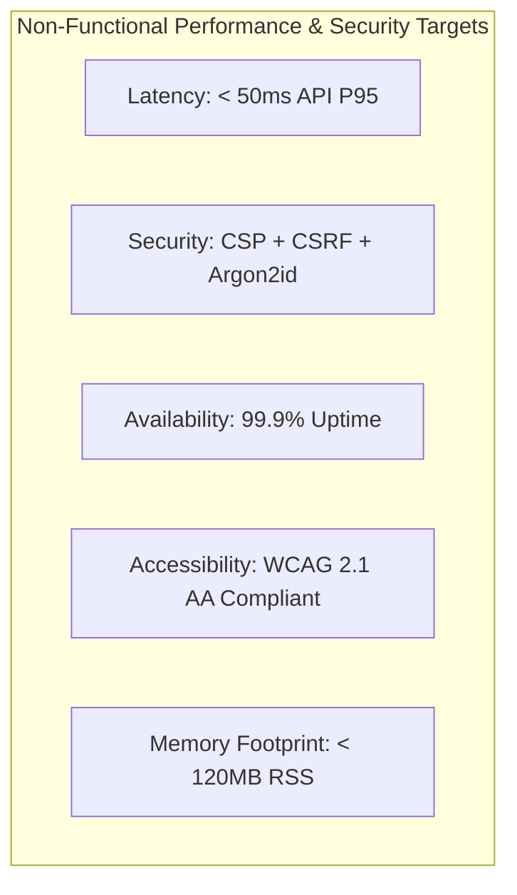

# Technical Requirements Document (TRD)

**Product Name:** Robotree Robotics Corporate & STEM Education Web Platform  
**Document Version:** 2.1.0  
**Status:** Approved & Implemented  
**Entity:** Robotree Robotics LLP (GeM & MSME Accredited Entity)  
**Author:** Principal System Architect  

---

## 01. Project Overview

| Attribute | Specification |
|:---|:---|
| **Product Name** | Robotree Robotics Corporate & STEM Education Platform |
| **Tech Stack (Primary)** | Node.js (ESM), Express 4.x, TypeScript 5.x, Vite, Vanilla Modern JS / CSS3 |
| **Short Description** | An enterprise web platform delivering high-performance STEM education catalogs, dynamic certificate validation, institutional lab inquiries, and live administrative governance. |
| **Document Purpose** | Defines the technical requirements, architecture, API interfaces, security guardrails, performance constraints, and deployment specifications for the platform. |

---

## 02. Technical Objectives

1. **Enterprise Layered Architecture:** Strictly enforce the **MVC + Services** pattern (`Route -> Middleware -> Controller -> Service -> Repository -> Database`) to decouple HTTP transport from business logic.
2. **Deterministic Type Safety:** Full TypeScript strict mode compliance across all backend services, repositories, controllers, and domain models with zero `any` evasions.
3. **Resilient Data Abstraction:** Interface-driven repository pattern enabling zero-downtime switching between local atomic JSON storage and production PostgreSQL databases.
4. **Zero-Trust Security Perimeter:** Rigorous CSRF defense with double-submit cookies, argon2id password hashing, timing-safe passcode evaluation, strict Content-Security-Policy (CSP), and automated rate limiting.
5. **Sub-second Response Times:** High-throughput async non-blocking I/O with optimized static asset caching and streaming compression (`gzip`/`brotli`).

---

## 03. System Requirements

### 3.1 Functional Requirements (Technical Perspective)
- **FR-TECH-1 (Authentication & Access Control):**
  - Session-based admin authentication leveraging cryptographically secure HMAC tokens.
  - Constant-time verification (`crypto.timingSafeEqual`) to prevent side-channel timing attacks.
  - Automatic expiration and rotation of admin session tokens.
- **FR-TECH-2 (Inquiry & Lead Ingestion):**
  - Public endpoints for general contact, newsletter subscription, and course interest.
  - Server-side email deduplication and RFC 5322 regex validation via Zod schemas.
  - Immediate append-only logging to audit trails for compliance.
- **FR-TECH-3 (Certificate Verification Engine):**
  - Public REST lookup endpoint returning canonical certificate records by serial ID.
  - Digital signature verification and accreditation badge metadata generation.
- **FR-TECH-4 (Dynamic Site Settings):**
  - Protected API endpoint (`PUT /api/admin/settings`) to update homepage hero metric numbers, labels, and government protocol notices.
  - Atomic persistence to disk ensuring zero corruption during concurrent writes.
  - Public consumption endpoint (`GET /api/site-settings`) for seamless client hydration.

### 3.2 Non-Functional Requirements (Technical Specifications)

- **Throughput:** Capable of handling 500+ requests/sec on modest single-core cloud VM instances.
- **Scalability:** Stateless HTTP tier allowing seamless horizontal scaling behind Nginx or AWS ALB.
- **Portability:** Containerized with Docker and Docker Compose for instant multi-environment deployment.

---

## 04. Technology Stack

### 4.1 Frontend Layer
- **Markup:** Semantic HTML5 with accessible ARIA landmarks and zero framework overhead.
- **Styling:** Modular CSS3 with Custom Properties (Design Tokens), Flexbox, CSS Grid, and responsive viewports.
- **Client Scripting:** Modern ES6+ JavaScript modules (`type="module"`), native `fetch` API, Lucide icon hydration.
- **Development Tooling:** Vite dev server on port `3000` with hot-module replacement (HMR).

### 4.2 Backend Layer
- **Runtime:** Node.js v20+ LTS (ECMAScript Modules `type: module`).
- **Language:** TypeScript 5.8+ compiled to `dist-server/`.
- **Framework:** Express.js 4.21+.
- **Validation:** Zod 3.24+ for runtime schema validation and sanitization.
- **Security:** Argon2 for cryptographic hashing, crypto module for token generation.
- **Telemetry:** Structured JSON logging with request IDs, response durations, and audit actor attribution.

### 4.3 Persistence Tier
- **Local / Edge Mode:** Atomic file-system JSON repositories (`data/` directory) with concurrency locks.
- **Enterprise / Cloud Mode:** PostgreSQL relational repository implementation via `pg` driver.
- **Repository Interface:** Pure TypeScript interfaces (`IUserRepository`, `IInquiryRepository`, `ICourseRepository`, etc.) completely decoupling callers from storage implementations.

---

## 05. External Integrations

| Service / System | Integration Type | Technical Purpose | Fallback Strategy |
|:---|:---|:---|:---|
| **Razorpay Payment Gateway** | Client SDK & Webhook API | Online course enrollment and payment processing | Manual bank transfer / institutional invoice request |
| **Email Transport (Nodemailer)** | SMTP / TLS | Automated inquiry confirmation and admin notification | Asynchronous queue with retry logging |
| **WhatsApp Business API** | Deep-link URI scheme | Direct customer support and instant counseling | Embedded contact inquiry fallback modal |
| **GeM / MSME Registries** | Reference verification | Compliance verification under Government of India protocols | Static legal protocol banner in footer |

---

## 06. Technical Constraints & Assumptions

### 6.1 Constraints
- **Zero Monolithic Bloat:** Legacy JavaScript monoliths (`app.js`, `schemas.js`) are permanently prohibited in favor of modular TypeScript controllers and services.
- **No Client Framework Overhead:** The public site must remain lightweight without heavy bundle sizes (e.g. Next.js/React hydration bloat) to ensure instant loading on rural Indian 3G/4G connections.
- **Government Compliance:** Absolute removal of proprietary copyright statements in favor of the official Government of India protocol notice.

### 6.2 Assumptions
- Node.js runtime environment has write access to the local `data/` and `logs/` directories when running in local JSON persistence mode.
- Administrators possess the active passcode (`Anni4515` or configured environment secret) to perform configuration changes.
